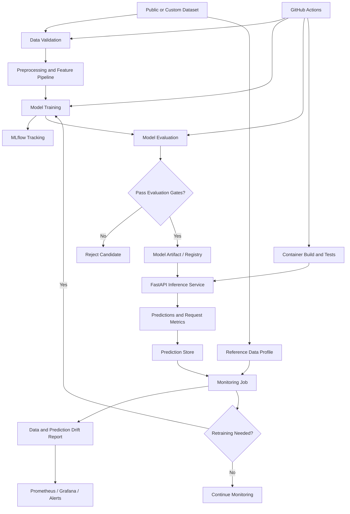

# MLOps with Model Monitoring

An end-to-end MLOps reference project for training, tracking, deploying, and monitoring machine learning models in production.

[](https://www.python.org/)
[](https://mlflow.org/)
[](https://fastapi.tiangolo.com/)
[](https://www.docker.com/)
[](LICENSE)

> A practical demonstration of how machine learning models move from experimentation to monitored production services.

## Overview

Training a machine learning model is only one part of the lifecycle. Once a model is deployed, its input data may change, prediction distributions may shift, latency may increase, and predictive performance may deteriorate.

**MLOps with Model Monitoring** provides a foundation for managing these challenges through a repeatable workflow covering:

- Data validation and preprocessing
- Model training and experiment tracking
- Model evaluation and artifact management
- Automated testing and containerized deployment
- Online inference and prediction logging
- Data drift and prediction drift monitoring
- Operational metrics, dashboards, and alerts
- Controlled retraining and model promotion

The initial implementation uses a conventional classification model so that the infrastructure and monitoring concepts remain the primary focus.

## Key Features

### Reproducible model training

- Load a public or custom dataset.
- Validate required columns, data types, and missing values.
- Build a reproducible preprocessing and training pipeline.
- Track parameters, metrics, and artifacts using MLflow.
- Compare candidate models against a baseline.

### Model evaluation and versioning

- Calculate appropriate classification or regression metrics.
- Generate evaluation reports and confusion matrices where applicable.
- Store model artifacts and evaluation metadata.
- Register and version models when a model registry is configured.
- Require an evaluation threshold before promoting a candidate model.

### Model serving

- Expose predictions through a FastAPI service.
- Validate inference requests with Pydantic.
- Package the service and dependencies in Docker.
- Record prediction latency and request failures.
- Support health checks and readiness checks.

### Model and data monitoring

- Compare incoming features with a reference dataset.
- Detect changes in feature distributions.
- Track prediction distributions and data quality.
- Evaluate predictive performance when ground-truth labels become available.
- Distinguish data drift from actual model performance degradation.

### Observability and alerting

- Export service metrics to Prometheus.
- Visualize operational health in Grafana.
- Generate drift reports with Evidently.
- Configure alerts for selected operational thresholds.
- Capture structured logs and useful diagnostic metadata.

### Automated workflows

- Run unit tests and integration checks in CI.
- Validate training and evaluation pipelines.
- Build and scan container images.
- Support scheduled or manually triggered retraining.
- Require approval before production model promotion.

## Architecture



## Technology Stack

| Component | Recommended technology |
|---|---|
| Language | Python 3.11+ |
| ML framework | scikit-learn |
| Optional advanced models | XGBoost |
| Data processing | pandas, NumPy |
| Experiment tracking | MLflow |
| Model monitoring | Evidently |
| API serving | FastAPI, Pydantic |
| Metrics | Prometheus |
| Dashboards | Grafana |
| Data and model artifacts | Versioned local storage or object storage |
| Database | PostgreSQL, where persistence is required |
| Packaging | Docker, Docker Compose |
| Testing | pytest |
| CI/CD | GitHub Actions |
| Optional orchestration | Kubernetes, Airflow, or Prefect |

Start with scikit-learn, MLflow, FastAPI, Evidently, and Docker. Add orchestration and Kubernetes only after the end-to-end workflow works reliably.

## Getting Started

### Prerequisites

- Python 3.11 or newer
- Git
- Docker and Docker Compose
- A public dataset or a suitable custom dataset

### 1. Clone the repository

```bash
git clone https://github.com/NotHarshhaa/mlops-model-monitoring.git
cd mlops-model-monitoring
```

### 2. Create a virtual environment

```bash
python -m venv .venv
```

Linux or macOS:

```bash
source .venv/bin/activate
```

Windows PowerShell:

```powershell
.venv\Scripts\Activate.ps1
```

### 3. Install dependencies

After configuring the project's `pyproject.toml`:

```bash
pip install -e ".[dev]"
```

### 4. Configure the environment

Create `.env` using `.env.example` as a template.

Example:

```dotenv
APP_ENV=development
LOG_LEVEL=INFO

MLFLOW_TRACKING_URI=http://localhost:5000
MODEL_NAME=baseline-classifier
MODEL_VERSION=

REFERENCE_DATA_PATH=data/reference.csv
PREDICTION_LOG_PATH=artifacts/predictions.jsonl

MONITORING_ENABLED=true
DRIFT_REPORT_PATH=reports/drift-report.html
```

These settings are loaded by `mlops_monitoring.config.Settings`. Relative paths
resolve against the project root (or `MLOPS_BASE_DIR` when set).

### 5. Train a baseline model

```bash
python scripts/train.py
```

If no dataset exists at `DATASET_PATH`, the script writes the bundled
scikit-learn breast cancer dataset there so the workflow runs offline. It then
validates the data, trains candidate models, evaluates them on a held-out split,
writes the reference dataset, and saves the model artifact. Results are
recorded in `reports/evaluation.json` and `reports/training-summary.json`.

Use `--no-mlflow` for a fully local run, or `--force` to save a candidate that
does not pass the evaluation gates.

### 6. Start experiment tracking

If MLflow is installed and configured for local tracking:

```bash
mlflow server --host 127.0.0.1 --port 5000
```

Open `http://127.0.0.1:5000` to inspect experiments.

For a shared or production deployment, configure persistent artifact storage and appropriate authentication rather than relying on a development server.

### 7. Start the inference service

```bash
uvicorn mlops_monitoring.api.main:app --reload
```

Expected development endpoints:

- API documentation: `http://localhost:8000/docs`
- Health endpoint: `http://localhost:8000/health`
- Readiness endpoint: `http://localhost:8000/ready`
- Model metadata: `http://localhost:8000/model/info`
- Prometheus metrics: `http://localhost:8000/metrics`

### 8. Run monitoring

Generate example traffic and labels, then run the monitoring job:

```bash
python scripts/simulate_traffic.py --rows 300
python scripts/run_monitoring.py
```

`simulate_traffic.py` replays held-out rows through the same prediction service
as the API. Add `--drift-shift 2.0` to shift selected numeric features by two
reference standard deviations and exercise the drift path.

The monitoring job compares incoming data with the reference dataset, joins any
available labels, generates drift and performance reports, and writes
Prometheus textfile metrics. Add `--fail-on-alert` to make it exit non-zero when
an alert is active.

### 9. Run the full stack

```bash
cp .env.example .env
docker compose build
```

Train once inside the API container so the artifact and reference data are
written to the mounted volumes:

```bash
docker compose run --rm api python scripts/train.py
```

Then start the stack:

```bash
docker compose up -d
```

Starting the API after training ensures it loads the freshly written model.

Services:

- Inference API: `http://localhost:8000`
- MLflow: `http://localhost:5000`
- Prometheus: `http://localhost:9090`
- Grafana: `http://localhost:3000` (default `admin` / `admin`)
- Node exporter: `http://localhost:9100`

Prometheus scrapes the API and reads drift/performance gauges from
`reports/monitoring.prom` through node_exporter's textfile collector. The
Grafana dashboard is provisioned automatically.

## Example Prediction API

The API accepts feature values and returns a prediction.

Example request:

```json
{
  "features": {
    "feature_a": 0.42,
    "feature_b": 12.5,
    "feature_c": 1
  }
}
```

Example response contract:

```json
{
  "prediction": 1,
  "model_name": "baseline-classifier",
  "model_version": "1",
  "latency_ms": 8.7
}
```

The feature names and prediction format must be adapted to the chosen dataset and model. The example values are illustrative, not real model results.

## Monitoring Strategy

A reliable monitoring implementation needs to separate several types of signals.

| Monitoring category | What it tells you | Example |
|---|---|---|
| Data quality | Whether inputs remain valid | Missing values or invalid ranges |
| Data drift | Whether feature distributions have changed | Population Stability Index or statistical tests |
| Prediction drift | Whether model outputs have shifted | Class distribution changes |
| Model performance | Whether predictions remain useful | F1, precision, recall, MAE |
| Service health | Whether the API operates reliably | Error rate, throughput, latency |
| Resource usage | Whether infrastructure is under pressure | CPU, memory, container utilization |

**Important:** Drift does not automatically mean a model is failing. A model can experience data drift without losing accuracy, and it can lose accuracy without a large drift signal.

Use actual ground-truth labels to measure predictive performance when they become available. For delayed labels, maintain a process to join them with previously logged predictions.

## Alerting and Retraining

A useful monitoring workflow should produce actionable signals rather than automatically retraining whenever a statistical threshold is crossed.

Recommended flow:

1. Collect and validate new inference inputs.
2. Compare feature distributions with the reference baseline.
3. Generate a monitoring report.
4. Trigger an alert when configured criteria are met.
5. Investigate the cause and check available ground-truth performance.
6. Launch a retraining job when justified.
7. Evaluate the candidate model against the current production baseline.
8. Promote the candidate only if it passes the configured acceptance gates.

Start with notifications and manual approval. Automated production promotion should be an explicit, tested capability rather than a default response to drift.

## Testing Strategy

- **Unit tests:** Validate preprocessing, training utilities, schemas, and metrics.
- **Integration tests:** Verify model loading, API inference, and artifact handling.
- **Data validation tests:** Detect missing columns, unexpected types, and invalid inputs.
- **Model tests:** Enforce minimum evaluation thresholds and compare against a baseline.
- **Monitoring tests:** Inject controlled distribution changes and verify the expected report or alert.
- **API tests:** Check response schemas, invalid requests, timeouts, and failure behavior.
- **Deployment tests:** Verify container startup, health checks, and configuration.

Run the test suite with:

```bash
pytest
```

## Development Roadmap

### Phase 1 — ML Baseline
- [x] Select a public classification dataset
- [x] Build a reproducible preprocessing pipeline
- [x] Train and evaluate a baseline model
- [x] Record experiments using MLflow
- [x] Save model artifacts

### Phase 2 — Model Serving
- [x] Build a FastAPI inference endpoint
- [x] Validate requests and responses
- [x] Add model loading and health checks
- [x] Package the application in Docker
- [x] Add unit and integration tests

### Phase 3 — Drift Monitoring
- [x] Establish reference data statistics
- [x] Log inference inputs and predictions safely
- [x] Generate data drift reports using Evidently
- [x] Monitor prediction distributions
- [x] Test monitoring with simulated drift

### Phase 4 — Observability
- [x] Instrument latency, throughput, and error metrics
- [x] Configure Prometheus scraping
- [x] Build Grafana dashboards
- [x] Add actionable alert rules
- [ ] Document incident investigation steps

### Phase 5 — MLOps Automation
- [x] Automate testing through GitHub Actions
- [x] Add model evaluation gates
- [x] Add artifact and model version management
- [x] Automate scheduled or manually triggered retraining
- [ ] Implement controlled model promotion and rollback

### Phase 6 — Advanced Production Deployment
- [ ] Add persistent storage and remote artifact management
- [ ] Add workload orchestration
- [ ] Add Kubernetes deployment manifests
- [ ] Integrate secrets management and image scanning
- [ ] Add model lineage and deployment audit records

## Security and Operational Considerations

- Never commit API keys, credentials, or sensitive datasets.
- Validate inference payloads and reject malformed requests.
- Apply authentication and rate limits when exposing the API.
- Avoid logging sensitive input features or personal information unnecessarily.
- Pin and scan dependencies and container images.
- Restrict access to MLflow tracking, artifact storage, and monitoring dashboards.
- Keep production model promotion auditable.
- Document rollback and recovery procedures.

## Contributing

Contributions are welcome!

1. Fork the repository.
2. Create a feature branch.
3. Add or update tests.
4. Run formatting, linting, and the test suite.
5. Open a pull request with a clear description of the change.

Potential contributions include new model types, monitoring metrics, dataset adapters, deployment examples, and observability integrations.

## License

This project is licensed under the Apache License 2.0. See [LICENSE](LICENSE).

## Author

**HARSHHAA**

- GitHub: [@NotHarshhaa](https://github.com/NotHarshhaa)

If you find the project useful, consider giving it a star or contributing improvements.

---

**Train reproducibly. Deploy confidently. Monitor continuously. Improve with evidence.**
